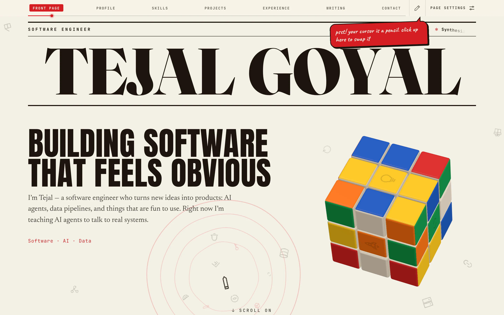
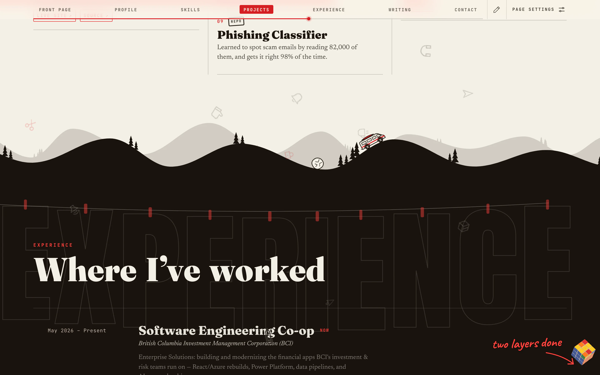

<a href="https://tgoyal.me"></a>

<div align="center">

<sub>VOL.&nbsp;I &nbsp;·&nbsp; NO.&nbsp;1 &nbsp;·&nbsp; INK STILL WET &nbsp;·&nbsp; FREE, AND WORTH EVERY PENNY</sub>

# The Press

**The source of [tgoyal.me](https://tgoyal.me), a personal site set like a newspaper.<br>It reads like one right up until you touch it.**

<sub>[Things to find](#things-to-find) &nbsp;·&nbsp; [How it's set](#how-its-set) &nbsp;·&nbsp; [Run your own press](#run-your-own-press) &nbsp;·&nbsp; [Distribution](#distribution) &nbsp;·&nbsp; [Colophon](#colophon)</sub>

</div>

---

**THE PRESS** — Cream paper, warm ink, press red, five typefaces and more rules than a style guide (mostly the horizontal kind). Today's forecast: cream all morning, ink by the afternoon, red by evening.

I didn't want a resume with hover states. I wanted a page that notices you're there. So your cursor is a pen, a click sends a ripple through the paper, and a Rubik's cube sits in the margin solving itself, one move at a time, as you scroll. A lot of it exists for no better reason than that it's nice to poke.

## Things to find

The site keeps this list in **Page settings** (top right of the running head) and ticks things off as you stumble onto them. You can't tick them yourself over there, and you can't tick them at all over here, so you'll have to go and look.

- [ ] **Make a wave on the paper.** Click any bare paper. The pencil icons drifting about get shoved aside and sway back.
- [ ] **Swap your pen.** Your cursor is a pencil, and the little pen up in the running head trades it for another. There's a rocket in there.
- [ ] **Turn a face of the cube.** Click a sticker to turn that face; Shift turns it the other way. Your twists stay. The cube never quietly undoes them.
- [ ] **Spin the whole cube round.** Hold and drag.
- [ ] **Catch the bug.** It lives beside the Projects headline, talks a big game, and is quicker than it looks.
- [ ] **Get the van to toss the boulder.** A camper van drives the ridge into Experience with a boulder rolling after it. Scroll back so the van turns round into it.
- [ ] **Spin the postage stamp.** It's on the letter at the bottom. It spins like a fidget spinner and copies my email while it's at it.
- [ ] **Leave a stamp on the sheet.** Type a word you're grateful for and press it down wherever you like.
- [ ] **Find the car.** Not the little line-drawn one on the rules. The other one.
- [ ] **See the cube solved.** Read to the end without touching it, or undo your own mess by hand. It only says solved when it is.

Also in this edition: the section names hang in huge wood type on a washing line and sway when your cursor blows past (wherever the pen touches a letter, it soaks up ink). The big headlines are loose type and lift near the cursor. The lead projects are case files on tiles that lean toward you in real CSS 3D; click one and it turns over to the full file in a wave of little square scales, a different wave for each project. The wire under the masthead crawls faster while you scroll, and a red rule along the running head fills in as you read.



<p align="center"><sub>Where the cream turns to ink. The boulder is always nearly there, never quite.</sub></p>

## How it's set

**The stack.** React 19 and Vite 7, Tailwind CSS v4, GSAP with Lenis for the one shared scroll loop, and three.js for anything with a third dimension. Hosted on Cloudflare Pages, with Pages Functions and D1 for the one part that talks back.

**The life layer** (`src/life`). One pointer tracker, one scroll tracker and one shared idea of what counts as bare paper, used by everything that reacts to you: the drifting icons, the ripples, the marks a click leaves, the pen, the cars, the bug. The motion is transforms and opacity, run off one shared GSAP ticker, and the canvases pause when the tab is hidden. Reduced motion gets a still page that reads exactly the same.

**The cube** (`src/cube`, `src/gl`). A stickerless speedcube in three.js, loaded after the first paint. It starts from one fixed scramble and plays a 44-move layer-by-layer solve spread across the sections, so an untouched cube is solved by the time you reach the bottom. Twist it and the solve carries on from wherever you left it, which usually means it isn't. `docs/cube/verify.py` replays the solve in the test suite, because a cube that ends the page unsolved on its own would be a very specific kind of embarrassing. It only draws a frame when something on it moved. The click it makes when a face turns is synthesised from a burst of noise; there isn't a single audio file in the repo.

**The gratitude sheet** (`functions/api/gratitude`, `lib/gratitude.js`). Anyone can stamp a word they're grateful for onto the sheet in Let's talk, anonymously, once a day. Turnstile checks you're a person, a salted daily hash stands in for your IP, Workers AI (Llama Guard) and a word list keep it kind, anything flagged waits for me in a review queue, and D1 holds the lot. It runs on the free plan, which can't send me a bill: past a limit, it just closes until midnight UTC.

| Page | What's on it |
|---|---|
| `src/sections` | The seven sections, in reading order |
| `src/press` | The newspaper itself: loader, nameplate, running head, seams, stamps, the bug |
| `src/life` | The life layer: pointer, scroll, ripples, icons, cars, banners, things to find |
| `src/cube`, `src/gl` | The cube's engine (pure, tested) and the three.js stage it lives on |
| `src/data` | The words: projects, experience, skills, and the blog, synced daily from my Jekyll feed by a GitHub Action |
| `functions`, `lib`, `db` | The gratitude sheet's backend and its schema |
| `docs` | The revamp plan and the cube's solve |
| `tests` | Unit tests (Vitest) and end-to-end checks (Playwright) |

## Run your own press

```bash
npm install
npm run dev        # dev server at localhost:5173
npm run build      # production build into dist/
npm run preview    # serve that build locally
npm test           # the cube's solve check (needs Python 3) + unit tests
npm run test:e2e   # Playwright, in Chromium and WebKit, against a production build
```

`npm run dev` is Vite on its own, so the gratitude sheet has no backend locally. It notices, says so politely, and takes nothing.

## Distribution

Cloudflare Pages prints every push. `main` is the live edition at [tgoyal.me](https://tgoyal.me), and every other branch gets its own preview URL, which is where new editions get proofread.

| Setting | Value |
|---|---|
| Build command | `npm run build` |
| Output | `dist` |
| Node | 20+ |

The gratitude sheet wants a D1 binding `DB`, a Workers AI binding `AI`, and three secrets: `TURNSTILE_SECRET`, `SALT` and `ADMIN_SECRET`. Its tables make themselves on first use; `db/gratitude.sql` is the same schema, for reference. Security headers live in `public/_headers`.

## Colophon

Set in **Fraunces** (the nameplate and heads), **Newsreader** (the reading), **Anton** (the shouting), **JetBrains Mono** (datelines and labels) and **Caveat** (the editor's pen), all from Google Fonts and all under the SIL Open Font License. The site serves its own cut-down copies (`src/fonts`, made by `scripts/fonts/build.py`), each still carrying its copyright and licence.

Hand-drawn icons by [matita-dev/icons](https://github.com/matita-dev/icons) (MIT). *Matita* is Italian for pencil. Nominative determinism remains undefeated.

Brand marks from [thesvg](https://github.com/glincker/thesvg) (MIT). The logos belong to their owners; they're only here to show what I work with.

There's no licence file, so the default applies: the code is mine and isn't licensed for reuse. Read it, learn from it, and if you'd like to borrow something, ask. I'll probably say yes. The icons and brand marks keep their own MIT licences, in `src/life/icons/LICENSE` and `src/life/brands/LICENSE`.

---

<div align="center">

<sub>WRITTEN, SET AND OCCASIONALLY BROKEN BY</sub>

**Tejal Goyal**

</div>
